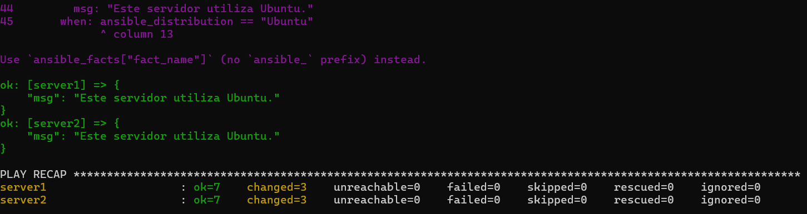

# Laboratorio Ansible con Docker

## Descripción
Laboratorio práctico para administrar dos servidores
Linux Ubuntu 24.04 utilizando Ansible y Docker Compose.

## Servidores
- server1: Ubuntu 24.04
- server2: Ubuntu 24.04

## Requisitos
- Docker
- Docker Compose
- Ansible
- Python 3
- Colección community.docker

## Ejecución

Iniciar los servidores:

    docker compose up -d

Verificar conexión:

    ansible docker -i inventory.ini -m ping

Ejecutar Playbook:

    ansible-playbook -i inventory.ini playbook.yml

## Resultado
Ambos servidores ejecutan las tareas definidas
en el Playbook y generan sus respectivos archivos
de información y directorios.

